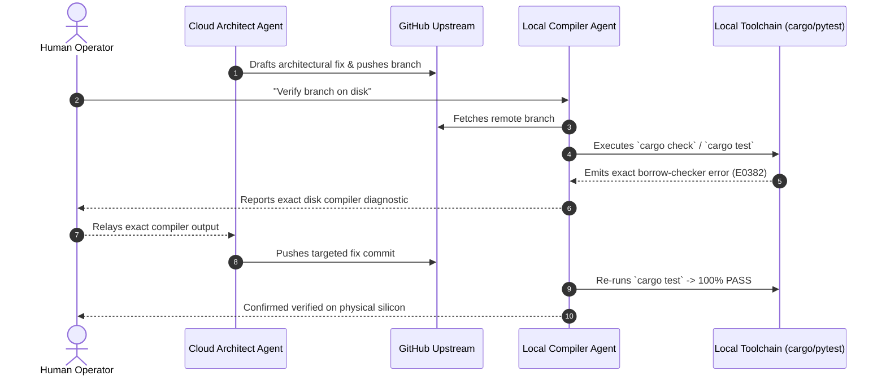

# Multi-Agent Relay Architecture: The Cloud Architect to Local Compiler Pattern

## Problem
Software engineering workflows utilizing Autonomous AI Agents frequently succumb to two failure modes:
1. **Monolithic Context Degradation:** Confining an entire project lifecycle (architectural design, code generation, dependency resolution, compilation, and testing) to a single model instance causes context window saturation, leading to hallucinations, repetitive editing loops, and silent code regressions.
2. **The "Hallucinated Pull Request" Anti-Pattern:** Cloud-only AI agents generate syntactically convincing code via API and assert that "all tests pass." When the pull request is pulled by maintainers, the build fails immediately on native toolchains due to borrow-checker violations, missing platform symbols, or subtle dependency mismatches.

## Environment
* **Architecture:** Heterogeneous multi-agent coordination across cloud and local execution layers.
* **Nodes:**
  * **Cloud Edge Node:** High-velocity architectural spec authoring and GitHub API PR triage.
  * **Local Compiler Node:** Host-level development terminal running native toolchains (`cargo`, `go`, `python`, `gcc`).
  * **Host Runtime:** Local developer workspace with isolated repository worktrees.

## What Was Observed

### 1. The Compiler Verification Gap
Cloud-hosted LLMs do not execute code against actual operating system kernels or native compilers; their assertions of correctness are probabilistic predictions. In complex compiled ecosystems (such as Rust), cloud agents repeatedly generate code that passes visual inspection but violates strict memory-safety invariants:

```text
# Illustrative diagnostic (demonstrating ownership transfer and borrow-after-move error patterns):
error[E0382]: borrow of moved value: `client`
  --> src/daemon.rs:142:18
   |
138|     let response = client.post(endpoint).send().await?;
   |                    ------ `client` moved due to this call
...
142|     let retry = client.get(status_url).send().await?;
   |                 ^^^^^^ value borrowed here after move
```

If pushed directly to public branches, these hallucinated successes waste human review cycles and break continuous integration (CI) pipelines.

### 2. Autonomous Loop Runaway
Allowing two autonomous agent instances to communicate directly without human gating often results in conversational death spirals, where agent A hallucinates a solution and agent B hallucinates agreement without either testing the change against disk truth.

## What Helped

### 1. The "Cloud Architect → Local Compiler" Relay Loop
To eliminate hallucinated PR failures, tasks are partitioned strictly between architectural drafting and local compiler verification:



1. **Cloud Authoring:** The cloud agent specs the cross-file interface and drafts the patch directly to a remote feature branch via GitHub API.
2. **Local Fetch & Compile:** The local agent checks out the branch on the physical developer machine and executes the native compiler suite (`cargo check --bin daemon`).
3. **Compiler Interception:** If a compiler error occurs, the local agent isolates the exact line number, compiler error code, and borrow trace directly from disk output.
4. **Targeted Upstream Patch:** The exact compiler diagnostic is fed back to the cloud agent, which pushes a corrective commit. The local agent verifies the patch on disk before human maintainers are asked to review.

### 2. Core Operational Invariant: Disk Truth Over Model Confidence
To maintain absolute codebase integrity across agent sessions:
* **Evidence Rule:** Never claim a test passed, a daemon restarted, or a bug was fixed unless backed by captured command output from the host terminal.
* **Human Relay Valve:** Keep the human operator as the intentional relay valve between agent nodes, preventing unmoderated agent-to-agent feedback loops.
* **Identity Containment:** Each agent operates under its native model identity and tool capabilities without role-playing or costume masking.

## Limits
* **Bandwidth & Latency:** Relaying diagnostics between cloud APIs and local machines introduces several seconds of network latency per turn compared to single-agent local execution.
* **Environment Divergence:** If the local host's compiler toolchain version differs from the upstream CI runner (e.g. Rust 1.78 locally vs 1.80 on GitHub Actions), toolchain discrepancies must be caught by containerized pre-commit checks.

## Related Field Notes
* [Agentic Engineering: Managing Long-Running Binary Porting Projects](agent-handoff-and-artifact-gating.md) — State management, handoff manifests, and artifact validation.
* [Autonomous Agent Monetization: Whop MCP vs. L402 Lightning Tollbooths](agent-monetization-whop-mcp-vs-l402-tollbooths.md) — Tool surfaces, MCP bridges, and transactional boundaries.

## Sources & Credit
* [Rust Compiler Diagnostics Guide](https://doc.rust-lang.org/error_codes/error-index.html) (`rustc --explain`).
* [Model Context Protocol (MCP) Specification](https://modelcontextprotocol.io/).
* [OpenClaw Project Architecture](https://github.com/openclaw).
