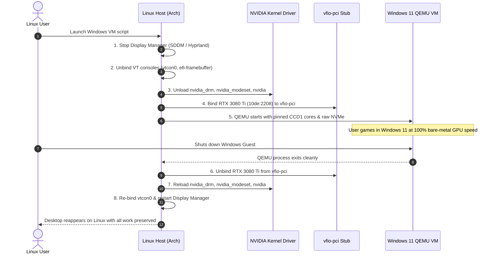

# Single-GPU Dynamic VFIO Passthrough: Hardware Topology & Driver Rebinding

> **Scope Notice:** This document is an architectural post-mortem and hardware topology breakdown drawn from physical bare-metal testing, **not a universal step-by-step tutorial**. Single-GPU VFIO passthrough depends strictly on your motherboard's IOMMU group isolation, UEFI firmware behavior, and display manager lifecycle. Do not execute driver unbind commands without an active out-of-band SSH session.

## Problem
Many software engineers and gamers want to use Linux as their daily operating system while retaining access to Windows for kernel-level anti-cheat games or specialized Windows-only hardware suites. Traditional solutions present severe friction:
1. **Dual-Booting:** Requires completely closing all open development environments, terminal sessions, and background compilers to reboot into a separate OS.
2. **Dual-GPU Passthrough:** Requires buying a secondary graphics card, consuming motherboard PCIe lanes, increasing power draw, and adding physical video switchers or Looking Glass software capture overhead.
3. **Standard Virtualization:** Emulated virtual GPUs lack DirectX 12 / Vulkan feature parity and trigger anti-cheat VM detection flags.

## Environment
* **CPU:** AMD 16-Core / 32-Thread Dual-CCD processor (e.g. Ryzen 9 5950X, Zen 3 architecture).
* **Motherboard:** AMD X570 chipset platform (SVM + IOMMU enabled).
* **GPU:** NVIDIA GeForce RTX 30-series (e.g. RTX 3080 Ti, Ampere GA102 architecture, Device ID `10de:2208`).
* **RAM:** 64 GB DDR4.
* **Host OS:** Arch Linux (Kernel 6.10+, Wayland / Hyprland, Limine bootloader).
* **Guest OS:** Windows 11 Pro (KVM / QEMU / OVMF UEFI, Q35 machine type).

## What Was Observed

### 1. Cross-CCX Latency Spikes in Gaming
The Ryzen 9 5950X contains two physical Core Complex Dies (CCDs) connected via Infinity Fabric. If a virtual machine's vCPUs are assigned randomly across both CCDs, threads communicating across the Infinity Fabric interconnect suffer a 3x cache latency penalty ($\approx 10\text{ ns}$ L3 intra-CCD vs. $\approx 30\text{ ns}$ inter-CCD), resulting in micro-stutter and frame-time jitter in competitive games.

### 2. Driver Unbind Lockups (`nvidia_drm` in use)
Attempting to unbind the NVIDIA kernel driver while the display manager (SDDM/Hyprland) is running or while the Linux console framebuffer (`efi-framebuffer`) holds a hardware lock causes the Linux kernel to panic or hang indefinitely:

```text
# Illustrative kernel diagnostic: unbinding while display manager or framebuffer holds active context
rmmod: ERROR: Module nvidia_drm is in use
rmmod: ERROR: Module nvidia_modeset is in use
Kernel: [Hardware lockup; display frozen at black screen]
```

### 3. `INACCESSIBLE_BOOT_DEVICE` on Raw NVMe Boot
Passing an existing bare-metal Windows installation on a raw NVMe partition (`/dev/nvme0n1p3`) directly to QEMU via a VirtIO-SCSI controller crashes Windows with a Blue Screen of Death (BSOD `INACCESSIBLE_BOOT_DEVICE`) unless Red Hat VirtIO storage drivers are pre-installed into the Windows Driver Store.

## What Helped

### 1. Execution Lifecycle: The Single-GPU Rebinding Loop
A single orchestrator script manages the complete transition without rebooting the physical machine:



### 2. Pre-VM Teardown Hook Script
Before QEMU initializes, the host display pipeline is detached in exact sequence:

```bash
#!/usr/bin/env bash
# /etc/libvirt/hooks/qemu.d/win11/prepare/begin/start.sh

# 1. Terminate desktop display manager
systemctl stop sddm.service

# 2. Unbind virtual terminal consoles and EFI framebuffers
echo 0 > /sys/class/vtconsole/vtcon0/bind
echo 0 > /sys/class/vtconsole/vtcon1/bind
echo efi-framebuffer.0 > /sys/bus/platform/drivers/efi-framebuffer/unbind 2>/dev/null

# 3. Sleep briefly to allow memory buffers to flush
sleep 2

# 4. Unload all NVIDIA driver kernel modules
modprobe -r nvidia_drm nvidia_modeset nvidia_uvm nvidia

# 5. Bind GPU VGA and Audio controllers to vfio-pci
virsh nodedev-detach pci_0000_0a_00_0
virsh nodedev-detach pci_0000_0a_00_1
```

### 3. CPU Chiplet Topology Pinning (Ryzen 5950X)
To eliminate cross-CCX cache latency:
* **CCD0 (Cores 0–7 / Threads 0–7 & 16–23):** Reserved exclusively for Linux host background tasks, compilers, and system daemons.
* **CCD1 (Cores 8–15 / Threads 8–15 & 24–31):** Pinned 1:1 to QEMU vCPUs for the Windows guest:

```xml
<vcpu placement='static'>16</vcpu>
<cputune>
  <vcpupin vcpu='0' cpuset='8'/>
  <vcpupin vcpu='1' cpuset='24'/>
  <vcpupin vcpu='2' cpuset='9'/>
  <vcpupin vcpu='3' cpuset='25'/>
  <!-- ... Cores 10-15 mapped to Threads 26-31 ... -->
  <emulatorpin cpuset='0-7,16-23'/>
</cputune>
<cpu mode='host-passthrough' check='none'>
  <topology sockets='1' dies='1' cores='8' threads='2'/>
</cpu>
```

### 4. Storage & VirtIO Integration
To allow the same Windows partition (`/dev/nvme0n1p3`) to boot both bare-metal and inside KVM:
1. Boot Windows bare-metal once to install drivers and set storage services to boot-critical (`Start=0`):
   ```cmd
   REM Install drivers into the Windows Driver Store
   pnputil /add-driver viostor.inf /install
   pnputil /add-driver vioscsi.inf /install
   pnputil /add-driver netkvm.inf /install

   REM Configure VirtIO SCSI storage service as boot-critical (Start = 0)
   reg add "HKLM\SYSTEM\CurrentControlSet\Services\vioscsi" /v Start /t REG_DWORD /d 0 /f
   reg add "HKLM\SYSTEM\CurrentControlSet\Services\viostor" /v Start /t REG_DWORD /d 0 /f
   ```
   *Fallback Alternative:* If manual registry addition fails or permissions are restricted, attaching a temporary secondary virtual disk backed by VirtIO-SCSI to the VM while booting Windows once via an emulated SATA/IDE controller causes Windows Device Manager to detect the controller and configure the service entries automatically.
2. In QEMU, attach the partition using `virtio-scsi` with discard enabled:
   ```xml
   <disk type='block' device='disk'>
     <driver name='qemu' type='raw' cache='none' io='native' discard='unmap'/>
     <source dev='/dev/nvme0n1p3'/>
     <target dev='sda' bus='scsi'/>
   </disk>
   ```
3. A udev rule in Linux prevents the host from ever mounting `nvme0n1p3` while QEMU is running, eliminating filesystem corruption.

### 5. Post-VM Recovery Hook Script
When QEMU terminates, the GPU is returned to the Linux kernel:

```bash
#!/usr/bin/env bash
# /etc/libvirt/hooks/qemu.d/win11/release/end/revert.sh

# 1. Re-attach GPU devices to host driver control
virsh nodedev-reattach pci_0000_0a_00_0
virsh nodedev-reattach pci_0000_0a_00_1

# 2. Reload NVIDIA kernel modules
modprobe nvidia
modprobe nvidia_modeset
modprobe nvidia_drm
modprobe nvidia_uvm

# 3. Rebind virtual terminal consoles
echo 1 > /sys/class/vtconsole/vtcon0/bind
echo 1 > /sys/class/vtconsole/vtcon1/bind

# 4. Restart desktop display manager
systemctl start sddm.service
```

## Limits
* **Motherboard IOMMU Grouping:** This setup requires that the primary PCIe x16 slot resides in an isolated IOMMU group. If the GPU shares an IOMMU group with the PCIe root complex or onboard SATA controllers, passthrough fails without the ACS override kernel patch.
* **Emergency SSH Requirement:** If a driver teardown script encounters a syntax error or a hung process, the physical display will remain black. An active SSH daemon on a secondary laptop or phone on the local LAN is mandatory during initial setup to inspect `journalctl -xe`.

## Related Field Notes
* [NVENC Hardware Encoding Architecture & Session Starvation](nvenc-hardware-encoding-architecture.md) — GPU encoder session allocation and driver boundaries.
* [Headless 24/7 Unattended Disk Unlock (LUKS2 + TPM 2.0)](headless-unattended-disk-unlock-tpm2.md) — Limine bootloader, kernel hooks, and disk orchestration.
* [PowerShell Processor Affinity Sign Extension](powershell-processor-affinity-sign-extension.md) — CPU core masking and affinity assignment.

## Sources & Credit
* [ArchWiki PCI Passthrough via OVMF](https://wiki.archlinux.org/title/PCI_passthrough_via_OVMF).
* [QEMU VirtIO Device Architecture Documentation](https://www.qemu.org/docs/master/system/devices/virtio/index.html).
* [Red Hat VirtIO Drivers for Windows](https://github.com/virtio-win/virtio-win-pkg-scripts).
